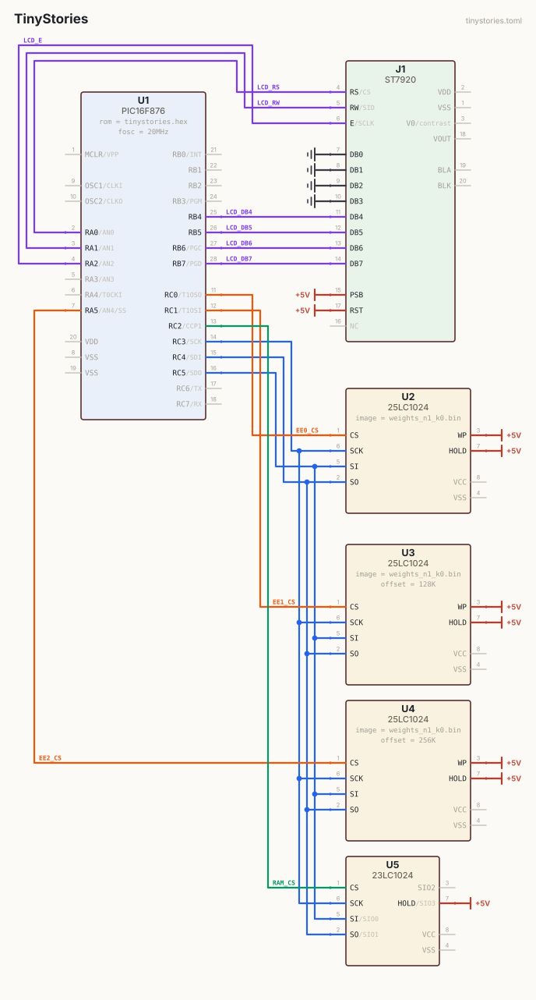

# TinyStories on a PIC16F876

`boards/tinystories` runs Karpathy's
[stories260K](https://huggingface.co/karpathy/tinyllamas) language model on
one PIC16F876 at 20 MHz and writes children's stories on the LCD, a token
every 6 seconds or so. The arithmetic is the integer model of
`tinystories/intmodel.py`, bit for bit: a test checks every intermediate
value against the Python reference.



## Running it

```sh
cd tinystories && python3 export.py && cd ..   # the weight image (needs model/, see tinystories/README.md)
cargo run --release -- boards/tinystories/tinystories.toml
vncviewer localhost:5900
```

The PIC starts with BOS and samples until the model writes BOS again,
then leaves a blank line and starts the next story. The random seed is a
build option: `gpasm -p p16f876 -D SEED=7 -o tinystories.hex
tinystories.asm` in `boards/tinystories`.

## The board

| Part | Role |
|---|---|
| U1 PIC16F876, 20 MHz | everything: 368 bytes of RAM, 8K words of flash, no multiplier |
| U2-U4 25LC1024 | the 269,880-byte weight image, 128K per chip (`image=`, `offset=`) |
| U5 23LC1024 | KV cache (90 KB) and scratch |
| J1 ST7920 | 128x64 LCD: 10 lines of 32 characters in a 4x6 font |

SPI is bit-banged on the MSSP pins (RC3 SCK, RC4 MISO, RC5 MOSI), so the
hardware SPI can take over later; each chip has its own select (RC0, RC1,
RA5, RC2). The LCD runs on a 4-bit bus: RS, RW, E on RA0-RA2 and DB4-DB7
on RB4-RB7, with DB0-DB3 tied to GND; the firmware polls its busy flag.
RC6/RC7 are the USART, for loading the weights. RB3 is left to low-voltage
programming: every firmware for the board keeps the config word's LVP bit
on, so the PIC can be programmed without 12 V (`tools/picprog`), and RB3
needs a 10 k pull-down to GND.

## Loading the weights

On a real board, the EEPROMs are written through the PIC: flash
`loader.hex` (from `loader.asm`), connect a 5 V USB-UART adapter (its TX
to RC7, its RX to RC6, GND to GND) and run

```sh
python3 boards/tinystories/load_weights.py /dev/ttyUSB0
```

It writes the image a 256-byte page at a time, with a CRC per page, then
reads it all back: about a minute at 115,200 baud. Then flash
`tinystories.hex`. The adapter has to have 5 V logic levels: the PIC's
RX is a Schmitt trigger input that needs 4 V for a 1.

`loader.toml` is the same board with the loader and the adapter on TCP
port 5555, to try it in the emulator:

```sh
cargo run --release -- boards/tinystories/loader.toml
python3 boards/tinystories/load_weights.py socket://localhost:5555
```

## Firmware

`tinystories.asm` with `fw_spi.inc`, `fw_math.inc`, `fw_core.inc`,
`fw_lcd.inc`; `data.inc` is generated by `gen_data.py` (lookup tables,
the vocabulary as the LCD shows it, the font, and the start-up screen).
The start-up screen, "Made with" over the Emularium logo and wordmark, is
drawn by `splash.py` into `splash.png`; it stays up while the first token
is computed, about 6 s.

Per token:

1. **Embedding**: the token's row of the classifier records, `x = w << (10 - e)`.
2. **Five layers**, the weights read as one SPI stream from the three
   EEPROMs (it reopens itself at chip boundaries and after any SRAM
   access):
   - RMSNorm: sum of squares (40 bit), `1/sqrt` from a table, block
     floating point (int8 mantissas, one exponent);
   - q, k, v: matmul rows of offset-binary bytes, `sum(ua*uw) - 128(S+A)`,
     with the multiply-accumulate of `tinystories/kernels`;
   - RoPE from a quarter-wave sine table;
   - this position's k and v, as BFP, into the KV cache (a 256-slot ring);
   - attention per head in two passes over the cache: the maximum score,
     then `exp2` weights, their sum, and the weighted sum of v; the output
     is scaled by `round(2^32 / sum)`;
   - wo and the residual; RMSNorm; the FFN unit by unit (SiLU from a
     sigmoid table) into SRAM; w2 and the residual.
3. **Classifier**: the final RMSNorm with its gain, 512 logits into SRAM.
4. **Sampling**: min-p (weights below 8/255 dropped), xorshift32.
5. **Printing**: the token's text, word-wrapped, scrolling a line at a time.

Everything is 8-bit arithmetic on 24-, 32- and 64-bit values in RAM; the
widths come from measuring every intermediate's range over a few hundred
positions. RAM: the residual stream (128 bytes) and the activations (up
to 172 bytes) take most of it; the attention output, the FFN's hidden
vector and the logits go through SRAM.

Code is in two flash pages: page 0 has everything the inner loops call,
page 1 the rest, calling page 0 through the `C0` macro.
`check_pages.py tinystories.lst` checks every CALL and GOTO against the
listing.

Time per token at 20 MHz: about 6 s, most of it the 259K multiply-
accumulates of the matmuls (each with a bit-banged SPI read) and, as the
context grows, attention. The emulator runs it at about real time.

## Tests

- `tinystories_fw_matches_reference` (`src/tinystories_fw_test.rs`)
  assembles the firmware, runs it on the board with the real image and
  stops at the `CK_` labels to compare x, the activations, q/k/v, the KV
  cache entries, the attention output, hb, the logits and the sampled
  token with `tinystories/out/vectors_seed1.txt`. 16 positions match.
  `TS_POSITIONS=n` checks more; skipped without `tinystories/out/`.
- `tinystories_story` (ignored) runs `TS_TOKENS` tokens and saves the
  screen as a PPM image.
- `loader_protocol` and `load_weights_script_fills_the_eeproms`
  (`src/weight_loader_test.rs`) run the loader on the board through the
  UART part: the protocol by hand, then `load_weights.py` across a chip
  boundary.
- `pic_usart_talks_to_the_host` (`src/uart_test.rs`) checks the PIC's
  USART against the UART part, and its frames with sigrok's UART decoder.
- `pic_reads_the_weight_eeproms` and `sigrok_decodes_eeprom_traffic` run
  `eeprom_test.asm`, the bring-up firmware, with a made-up image.
